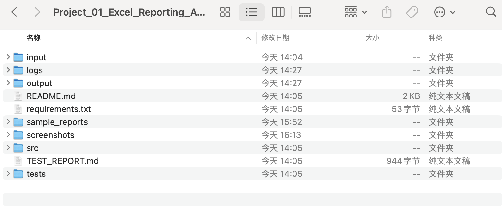
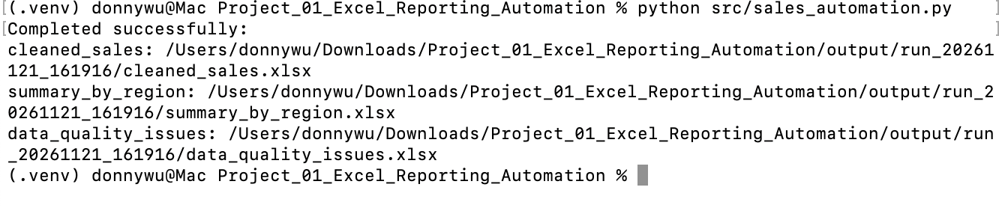
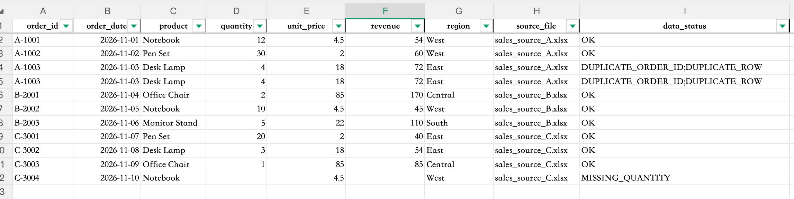
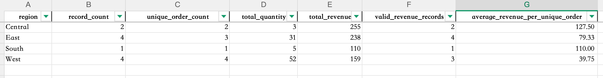
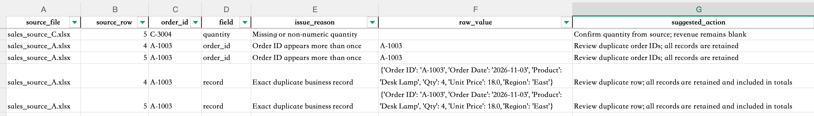

# Project 01 — Automated Sales Reporting & Data Cleaning Pipeline

A Python-based Excel automation solution that consolidates sales data from multiple Excel files, standardizes inconsistent fields, validates data quality, calculates revenue, and generates structured business reports.

Designed to reduce repetitive spreadsheet work, improve data consistency, and make sales reporting more reliable.

## Project Overview

This project automates a typical sales reporting workflow involving three Excel source files.

The pipeline processes the source data and generates three Excel reports:

- A standardized sales detail report
- A regional sales summary
- A data quality issue report

It also preserves original source files and records data validation issues without silently deleting problematic records.

## Key Features

- **Multi-file consolidation:** Combines three Excel sales files into one standardized dataset.
- **Data standardization:** Maps inconsistent source fields into a consistent schema.
- **Automated revenue calculation:** Calculates revenue using quantity × unit price.
- **Duplicate detection:** Identifies repeated order IDs and exact duplicate business records.
- **Data quality validation:** Detects missing, invalid, and inconsistent values.
- **Automated Excel reporting:** Generates three structured Excel output files.
- **Input integrity protection:** Calculates SHA-256 hashes before and after processing to verify that source files remain unchanged.
- **Timestamped outputs:** Creates a separate output folder for each run to avoid overwriting previous reports.
- **Automated testing:** Includes tests for data processing, reporting, integrity checks, and output generation.

## Screenshots

### 1. Project Structure



### 2. Successful Execution



### 3. Cleaned Sales Data



### 4. Regional Sales Summary



### 5. Data Quality Report



## Sample Deliverables

The project generates three Excel reports:

| Output File | Description |
|---|---|
| `cleaned_sales.xlsx` | Standardized sales transaction details with validation flags |
| `summary_by_region.xlsx` | Regional sales performance and revenue metrics |
| `data_quality_issues.xlsx` | Detailed issue log with source file, row, field, raw value, and suggested action |

Sample output files are available in the [`sample_reports/`](sample_reports/) folder.

## Data Processing & Business Rules

The following rules are applied consistently throughout the pipeline:

- Source C's `Unit Cost` field is interpreted as sales unit price and mapped to `unit_price`.
- Duplicate records are retained, flagged, and included in summary calculations.
- Missing or invalid quantity or price prevents revenue calculation. Revenue remains blank rather than being estimated.
- Missing IDs, products, regions, or dates are retained and flagged.
- Quantity values less than or equal to zero are flagged.
- Negative prices are flagged.
- Repeated order IDs are marked as `DUPLICATE_ORDER_ID`.
- Exact duplicate business records are marked as `DUPLICATE_ROW`.
- Multiple validation flags can apply to the same record.

### Summary Calculation Rules

- `record_count` includes all retained rows.
- `unique_order_count` counts distinct order IDs.
- Revenue totals ignore records with missing revenue values.
- Duplicate records remain included in the summary, consistent with the project's confirmed business rules.

## Project Structure

```text
Project_01_Excel_Reporting_Automation/
├── input/
├── sample_reports/
├── screenshots/
├── src/
│   └── sales_automation.py
├── tests/
│   └── test_sales_automation.py
├── .gitignore
├── README.md
├── TEST_REPORT.md
└── requirements.txt
```

Generated reports and execution logs are stored separately in timestamped output folders and local log directories.

## Installation

Python 3.10 or later is recommended.

Clone the repository:

```bash
git clone https://github.com/donnyddg123/Project_01_Excel_Reporting_Automation.git
cd Project_01_Excel_Reporting_Automation
```

Create and activate a virtual environment:

```bash
python3 -m venv .venv
source .venv/bin/activate
```

Install dependencies:

```bash
python -m pip install -r requirements.txt
```

## Run the Automation

From the project root directory:

```bash
python src/sales_automation.py
```

Generated reports are saved under:

```text
output/run_YYYYMMDD_HHMMSS/
```

Execution logs are stored in:

```text
logs/
```

## Run Tests

Execute:

```bash
pytest -q
```

The test suite covers:

- Reading and standardizing all three source files
- Revenue calculations
- Missing and invalid data handling
- Duplicate detection
- Regional summary calculations
- Inclusion of retained duplicate records
- Input file integrity verification
- Output file generation
- Timestamped output collision safety

**Latest verified test result:** 4 tests passed.

## Technical Stack

- Python
- pandas
- openpyxl
- pytest
- Git / GitHub
- Microsoft Excel-compatible `.xlsx` reporting

## Project Goal

This project demonstrates how Python can turn repetitive Excel-based sales reporting into a consistent, repeatable, and testable workflow.

It is a practical example of Excel automation, data cleaning, business reporting, and data quality validation.